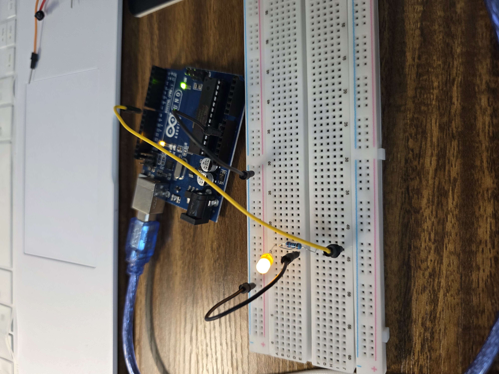
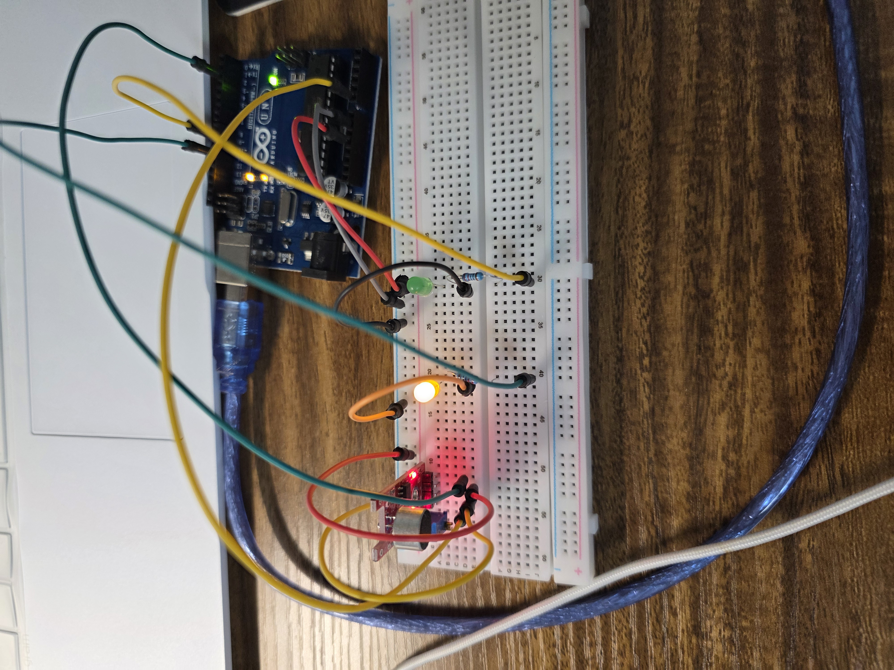
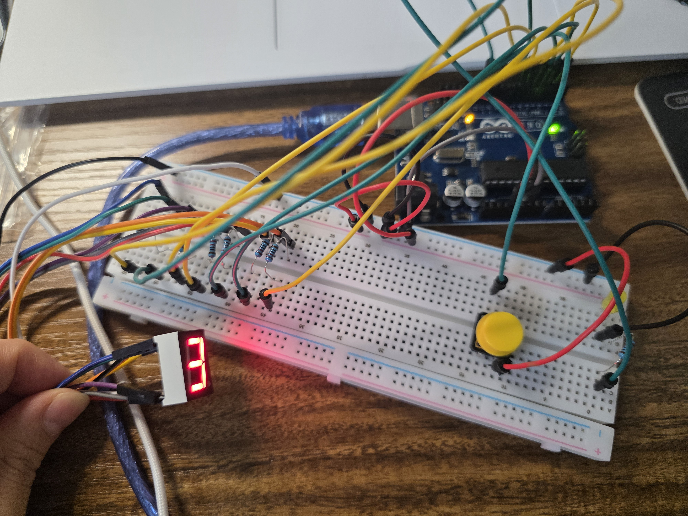

# 아두이노 우노 실습 2 (2026-10-20)

빵판 LED, 가변저항, 사운드 센서, 7세그먼트(FND)를 다룬 실습 코드 모음입니다.

| 폴더 | 내용 |
| --- | --- |
| [blink_pin8](blink_pin8) | 실습1: 빵판에서 8번 핀 LED 깜빡이기 |
| [pot_dimmer](pot_dimmer) | 실습2: 가변저항으로 LED 밝기 조절 (PWM) |
| [sound](sound) | 실습3: 사운드 센서로 소리가 날 때마다 LED 토글 |
| [soundtwoLED](soundtwoLED) | 실습4: 소리 유무에 따라 LED 2개 켜기 |
| [FND](FND) | 실습5: 버튼을 누를 때마다 7세그먼트 숫자 증가 |
| [fndled](fndled) | 실습6: 카운트다운 LED + 버튼 점수 게임 (세그먼트 응용) |

원본 강의 메모는 [강의내용.txt](강의내용.txt)에 있습니다.

## 실습1) LED 깜빡이기 (빵판 버전)

- 디지털 8번 핀 → 저항 → LED → GND로 연결하고 1초 간격으로 `HIGH`/`LOW`를 반복합니다.

## 실습2) 가변저항으로 밝기 조절

- 가변저항 가운데 다리 → A0, LED → 9번(PWM 핀, `~` 표시).
- `analogRead`로 읽은 0~1023 값을 `map(raw, 0, 1023, 0, 255)`로 바꿔 `analogWrite`에 넣습니다.
- `delay()` 대신 `millis()`로 100ms마다 시리얼에 `ADC`, `PWM`, 전압(`raw × 5.0 / 1023`)을 출력합니다.

## 실습3) 사운드 센서

| 센서 핀 | 연결 |
| --- | --- |
| A0 (아날로그 출력) | A0 |
| D0 (디지털 출력) | D2 |
| G | GND |
| + | 5V |
| LED | D9 |

- D0는 센서 보드의 가변저항(감도)으로 정한 기준을 넘으면 신호가 바뀝니다. 보드에 따라 활성 레벨이 다를 수 있어 `ACTIVE_LEVEL`로 바꿀 수 있게 했습니다.
- 소리가 감지될 때마다 LED를 토글하고, 250ms 쿨다운으로 한 번의 소리가 여러 번 세지지 않게 합니다.
- 마이크 아날로그 출력은 파형이라 순간값보다 20ms 구간의 **최대-최소 차이(Peak-to-Peak)** 를 보는 게 소리 크기 판단에 유리합니다.

▶ 동작 영상: [sound 센서 영상.mp4](sound/sound%20센서%20영상.mp4)

## 실습4) 소리에 따라 LED 2개 (soundtwoLED)

- 소리가 안 들리면 빨간 LED(D11) ON, 소리가 들리는 중이면 초록 LED(D9) ON + 빨간 LED OFF.
- D0 신호는 파형 때문에 짧게 깜빡이므로, 마지막 소리 이후 200ms(`HOLD_MS`) 동안은 "들리는 중"으로 유지합니다.

## 실습5) FND (7세그먼트) 카운터

- 공통 캐소드(COM = GND) 7세그먼트, A~G 각각 330Ω 저항.
- 숫자 0~9의 세그먼트 모양을 비트로 저장(`0x3F`, `0x06`, …)하고 `bitRead`로 A~G 핀에 하나씩 출력합니다.
- 버튼(D10, `INPUT_PULLUP`)을 35ms 디바운싱해서 누를 때마다 숫자가 1씩 증가(9 다음 0). 0일 때 D11 LED가 켜집니다.

### 배선표

| Arduino | 빵판과 직렬 저항 | 부품 핀 이름 | 3161AS 다리 번호 | 5161AS 다리 번호 |
| --- | --- | --- | --- | --- |
| D2 | 2j → 2f → 330Ω → 2b → 2a | A (맨 위) | 10번 | 7번 |
| D3 | 5j → 5f → 330Ω → 5b → 5a | B (오른쪽 위) | 9번 | 6번 |
| D4 | 8j → 8f → 330Ω → 8b → 8a | C (오른쪽 아래) | 8번 | 4번 |
| D5 | 11j → 11f → 330Ω → 11b → 11a | D (맨 아래) | 5번 | 2번 |
| D6 | 14j → 14f → 330Ω → 14b → 14a | E (왼쪽 아래) | 4번 | 1번 |
| D7 | 17j → 17f → 330Ω → 17b → 17a | F (왼쪽 위) | 2번 | 9번 |
| D8 | 20j → 20f → 330Ω → 20b → 20a | G (가운데) | 3번 | 10번 |
| GND | Arduino GND → 아래쪽 (-) 레일 → 각 COM 다리 | COM | 1번·6번 모두 | 3번·8번 모두 |
| 미연결 | 미연결 | DP (소수점) | 7번 | 5번 |
| D10 | 25j → 버튼 한쪽(25e·25f) | 버튼 입력 | - | - |
| GND 레일 | 23j → 버튼 다른 쪽(23e·23f) | 버튼 접지 | - | - |
| D11 | 29j → 29f → 220Ω → 29b → 29a | LED A(+) | - | - |
| GND 레일 | 28e → 28a | LED C(-) | - | - |

▶ 동작 영상: [세그먼트 영상.mp4](FND/세그먼트%20영상.mp4)

## 실습6) 세그먼트 응용 게임 (fndled)

**문제:** LED 3개(빨강 D13, 주황 D12, 초록 D11), 세그먼트, 스위치 사용

- 아두이노 내부에서 10초 카운트다운을 시작하고, 남은 시간에 따라 빨강 → 주황 → 초록 순서로 LED가 바뀝니다.
- 초록일 때 스위치를 누르면 세그먼트 점수 +1, 그 외 상태에서 누르면 -1 (0 미만으로 내려가지 않음).
- 9점이 되면 모든 LED가 3초 동안 깜빡인 뒤 초기화됩니다.

**구현 포인트**

- 남은 시간 10~7초: D13, 7~4초: D12, 4~0초: D11. 카운트다운이 끝나면 다시 10초부터 반복합니다.
- 짧게 누르면 버튼을 **뗄 때** 점수를 처리하고, 1.5초 이상 길게 누르면 LED와 세그먼트를 전부 끕니다. 꺼진 상태에서 다시 누르면 처음부터 시작합니다.
- `delay()` 없이 `millis()`만으로 카운트다운, 깜빡임, 버튼 디바운싱을 동시에 처리합니다.

▶ 동작 영상: [FND_LED영상1.mp4](fndled/FND_LED영상1.mp4) · [FND_LED영상2.mp4](fndled/FND_LED영상2.mp4)
